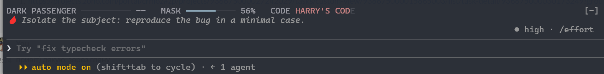

# Dexter for Claude Code

A Claude Code mod themed on a certain Miami blood spatter analyst with a dark hobby. Your session stats become his: the Dark Passenger grows as context fills, the Mask wears thin with the 5-hour limit, and the letters of Harry's Code go dark as the weekly limit is used.



Fan theme. All lines are original, not quotes from the show. Sounds are synthesized. Not affiliated with or endorsed by the show's creators or network.

## Install

At the prompt of a Claude Code terminal session:

```
/plugin install dexter --marketplace I3rixon/claude-dexter
```

Answer `y` to add the marketplace, then press Enter to pick the user scope. The mod is active right away. No `git clone` needed.

From a shell:

```
claude plugin install dexter --marketplace I3rixon/claude-dexter
```

In the desktop app, where `/plugin` does not run: click **+** next to the prompt box, then **Plugins**, **Add marketplace** with `I3rixon/claude-dexter`, then **Add plugin**.

To update or remove it later:

```
claude plugin update dexter
claude plugin uninstall dexter
```

## What it does

- **Stat bars above the prompt**
  - **DARK PASSENGER**: context fill. Turns restless at the threshold (default 30%) and shows one toast: time to `/compact` or hand off.
  - **MASK**: what is left of the 5-hour limit.
  - **CODE**: the weekly limit. The letters of `HARRY'S CODE` go dark as the limit is used.
  - Mask and Code need a Claude subscription; with an API key they show `n/a`.
- **Spinner verbs**: "Analyzing blood spatter", "Wrapping in plastic", ... Rotates about every 30 s.
- **Turn footer**: "Bagged for 12s", "Disposed of for 1m 4s".
- **Tips**: one dev tip under the bars, a new one each turn.
- **Sounds** (soft): one note when a turn ends, two notes when a permission is needed.
- **Break timer**: `/timer 45m` shows a countdown above the prompt. When it ends, a window asks you to step out of the kill room. Its button unlocks after 10 s.

## Commands

| Command | What it does |
|---|---|
| `/dexter` | Show the current stats |
| `/dexter on` / `/dexter off` | Turn the theme on or off (kept across sessions) |
| `/dexter tip` | Show a random tip |
| `/timer 45m` | Start a break timer (`90s`, `45m`, `1h30m`, or a number of minutes) |
| `/timer status` / `/timer off` | Show or cancel the timer |

## Settings

Run `/plugin configure dexter@claude-dexter`, or open `/config`:

- `passengerThreshold`: context fill (%) at which the Dark Passenger turns restless. Default `30`.
- `sounds`: play sounds. Default `true`.

## Platform notes

- **Windows**: sounds play through PowerShell; the break popup is a small WinForms window.
- **macOS**: sounds play through `afplay`; at the end of a break you get a toast and a chime instead of a window.
- **Linux**: no sounds; the break shows a toast.

## See also

[Constant Reader](https://github.com/I3rixon/claude-constant-reader): the same mechanics for Stephen King fans. Keep only one of the two enabled at a time.

## Files

- `hooks/register.tsx`: the hooks module
- `hooks/lines.ts`: spinner verbs, footer words and tips (edit these to make it yours)
- `sounds/*.wav`: synthesized sounds
- `scripts/break.ps1`: Windows break popup

## License

MIT. See [LICENSE](LICENSE).
